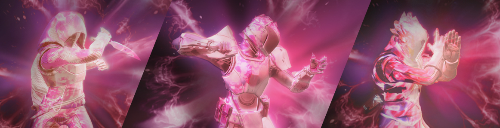
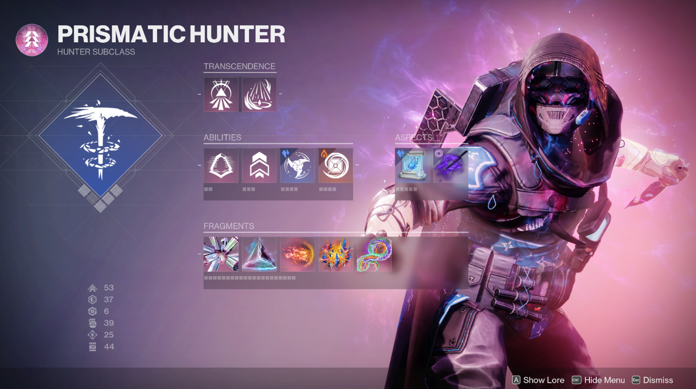
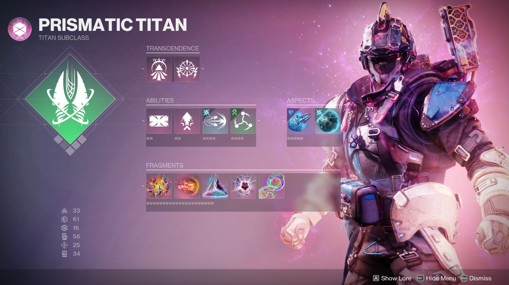
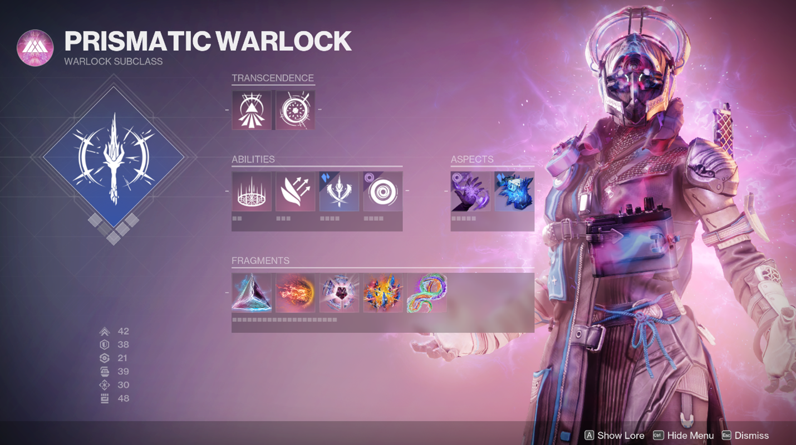



# Dungeons and a Space Wizard

### What if your next raid began with a roll of the dice?

**A fan-made Destiny 2-inspired 2D dungeon RPG concept.**

**By Amrish Rajeev · Being created with AI assistance**

Destiny 2 reference imagery © Bungie. Not a screenshot of Dungeons and a Space Wizard.

---

> [!NOTE]
> **Still on the drawing board.** Dungeons and a Space Wizard is currently a design concept. There is no playable build or release date yet. Everything teased here is a direction to explore, subject to change.

## A different kind of descent

Imagine a familiar power in an unfamiliar form.

A Guardian on a 2D dungeon map. A sealed chamber beneath your feet. A fireteam debating its next move. Somewhere beyond the door, a raid mechanic waiting to be understood.

The idea behind **Dungeons and a Space Wizard** is to bring Destiny-inspired class fantasy into a tactical, tabletop-style adventure—with room for an AI dungeon master to help tell the story.

## Three paths into the dark

<table>
  <tr>
    <th width="33%">HUNTER</th>
    <th width="33%">TITAN</th>
    <th width="33%">WARLOCK</th>
  </tr>
  <tr>
    <td></td>
    <td></td>
    <td></td>
  </tr>
  <tr>
    <td align="center">Find the opening.</td>
    <td align="center">Hold the line.</td>
    <td align="center">Change the battlefield.</td>
  </tr>
</table>

The ambition: explore all three Guardian classes and their subclasses, with the defining passives folded into balanced kits. No separate Aspect selection—just a class fantasy to build around.

**Arc · Solar · Void · Stasis · Strand · Prismatic**

## What lies below?

| A glimpse of the plan                 | The possibility                                                                          |
| :------------------------------------ | :--------------------------------------------------------------------------------------- |
| 🏛️ **Raid-inspired depths**           | Multiple floors, strange mechanisms, and a boss beyond the final door.                   |
| 👥 **Alone or together**              | Aiming for solo play through six-player fireteams, with challenges adapted to the group. |
| ⚔️ **A tactical twist**               | Planned turn-based encounters built around positioning, weapons, abilities, and Supers.  |
| 🎲 **Something worth opening**        | A limited arsenal of weapons and armor, discovered through random drops.                 |
| ✨ **A story with room to improvise** | AI-assisted narration and conversations that could react to your choices.                |

**First inspiration under consideration: Vault of Glass.**

Think ancient plates, cryptic sequences, and rooms where time might refuse to behave. The plan is to reinterpret those ideas for this game's format and fireteam sizes.

## Familiar weapons. New decisions.

A future Bungie API connection is planned to provide Destiny 2 weapon and armor catalog information. From there, the idea is to adapt a small, curated selection into gear with meaningful tactical differences.

Which weapon would you hope to find before the next floor?

## More than a dialogue choice

_“Could we distract the guard instead?”_

That's the kind of question this project hopes to make room for: creative approaches interpreted with AI assistance, checked against game rules, and woven into the narration.

The intended boundary is simple: code would resolve combat and rewards; AI would help tell the story around them.

## Follow the idea as it takes shape

The current work is planning the Guardian kits, dungeon structure, loot, and solo-to-six-player scaling. The first development goal is a small movement-and-combat prototype using Phaser and TypeScript.

For the detailed direction, see the [game design document](GAME_DESIGN.md). Playable previews and setup instructions can follow once there is a build to share.

---

### A fan project by Amrish Rajeev

Dungeons and a Space Wizard is being created with **AI assistance**, currently supporting its planning and documentation. AI assistance in development is separate from the proposed in-game storytelling features.

This is an unofficial fan-made project, unaffiliated with and not endorsed or sponsored by Bungie. Destiny, Destiny 2, and associated characters, artwork, names, and trademarks belong to their respective owners.

The reference images above come from Bungie's [Prismatic Deep Dive](https://www.bungie.net/7/en/News/article/prismatic_deep_dive). They show the inspiration, not a playable game. See [image credits and original sources](docs/images/README.md).

**The fireteam hasn't assembled yet.**

_This is where the idea begins._

